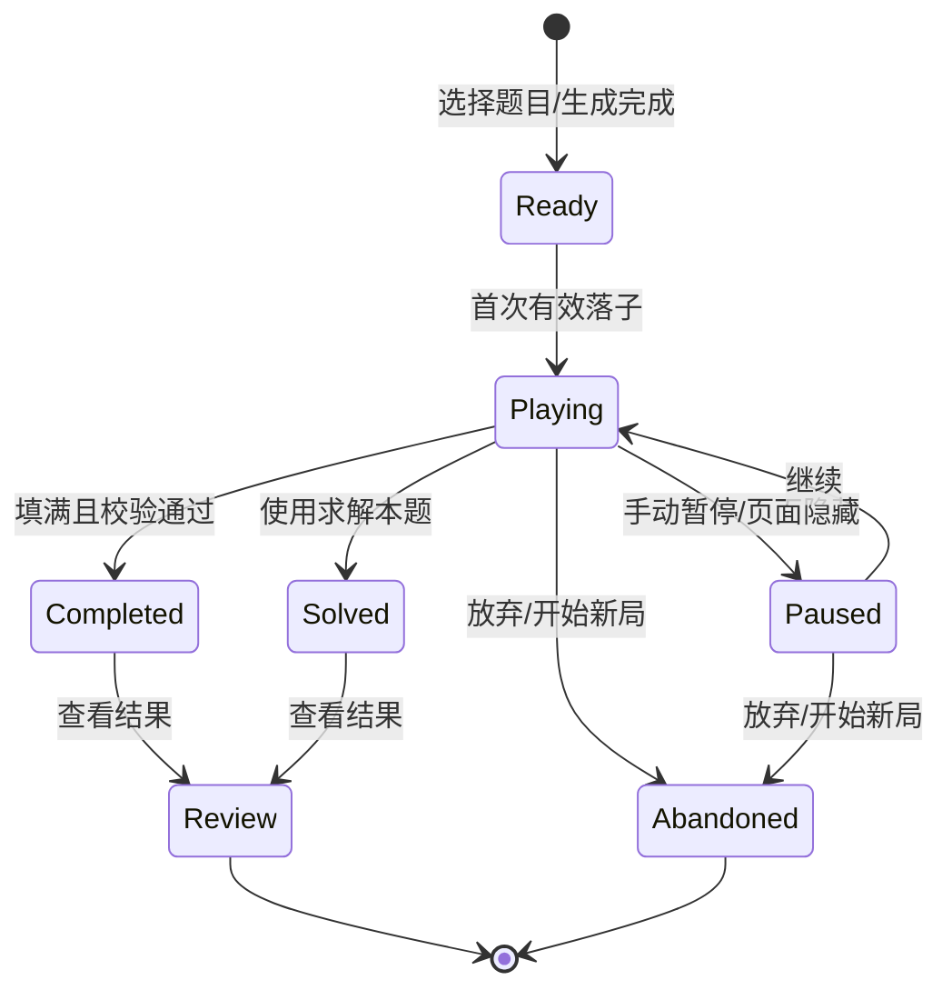
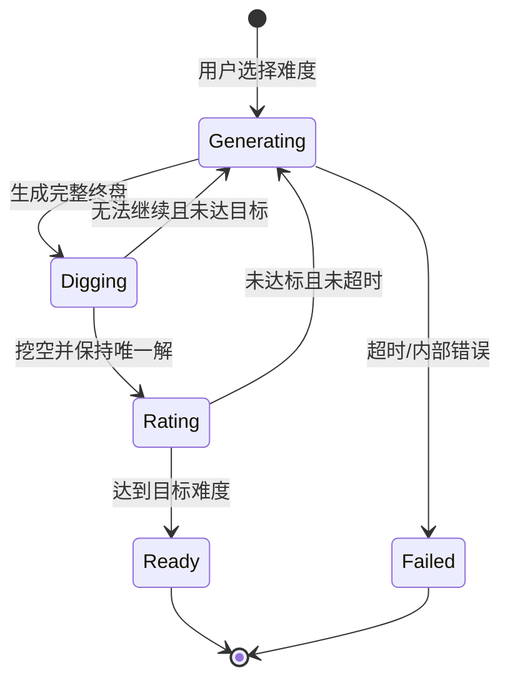

# 数独软件需求规格说明书

| 项目 | 内容 |
|---|---|
| 文档名称 | 数独软件需求规格说明书 |
| 文档编号 | SUDOKU-SRS-001 |
| 文档版本 | V1.6 |
| 文档状态 | 评审通过 |
| 编制日期 | 2026-10-29 |
| 适用产品 | 单机版数独 Web 应用 / PWA |
| 需求基线 | V1.5（P0）及后续迭代规划 |
| 维护方式 | 需求编号稳定，变更需记录变更单并更新版本 |

> **阅读提示**：本文以“响应式 Web 应用、本地优先、无需注册、单机游玩”为默认产品形态。若后续改为原生桌面端、移动端 App 或需要账号与云同步，应优先复核第 2.2、5.4、6、7 章，其余核心业务规则和功能需求可以复用。

## 修订记录

| 版本 | 日期 | 修订内容 | 修订人 |
|---|---|---|---|
| V1.0 | 2026-10-29 | 建立完整需求基线：补充生成、对局、校验、求解、自定义、收藏、数据、非功能与验收标准 | 产品/研发联合评审 |
| V1.1 | 2026-10-29 | 确认 D1–D10 产品决策，关闭待确认事项，明确 MVP 无障碍验收门槛 | 产品/研发联合评审 |
| V1.2 | 2026-10-30 | 变更 D6：检查答案不再计为辅助；检查改为棋盘填满后自动触发，移除手动入口；"还差 N 格"改为状态栏实时展示 | 产品确认 |
| V1.3 | 2026-10-30 | 取消离线游玩（原 AC-10）：移除 Service Worker 与预缓存，保留 PWA 可安装性；同步调整 §2.2、§2.3、§2.5、§7.5、NFR-PERF-006、§8.3、§9.2、D3。变更原因：单人自用项目，离线能力的实现与维护成本高于实际收益 | 产品确认 |
| V1.4 | 2026-10-30 | 采纳 D11：运行时改为从构建期题库取题，不再实时挖空生成；难度以技巧评级为唯一依据，提示数降为参考值（§3.5、§3.6、FR-GEN-001、FR-GEN-007、§4.2 生成流程、NFR-PERF-001、AC-01 同步调整）。原因：运行时生成在浏览器有内存与稳定性问题，简单档单次成功率仅约 30% | 产品确认 |
| V1.5 | 2026-10-30 | 取消多标签页协调（原 AC-14 / FR-PLY-013 / NFR-REL-006）：移除 Web Locks 与 BroadcastChannel 协调、只读提示与接管 UI。原因：实现存在卸载与重建的时序竞态，浏览器回退导航会被误判为「第二个标签页」而误置只读；单人自用场景下数据覆盖风险可接受 | 产品确认 |
| V1.6 | 2026-10-30 | 取消三项 P1 能力：分级提示（FR-HNT-001~006）、多解练习模式（§3.4 第 3 条、FR-CUS-006 的 P1 部分）、英文界面（FR-SET-002、NFR-I18N-002 的 en-US 部分）。原因：单人自用项目，这三项投入产出比低；提示需要独立的技巧检测子系统，练习模式与英文在自用场景下几乎不会用到 | 产品确认 |

## 目录

- [1. 引言](#1-引言)
- [2. 产品概述](#2-产品概述)
- [3. 业务规则](#3-业务规则)
- [4. 功能需求](#4-功能需求)
- [5. 非功能需求](#5-非功能需求)
- [6. 数据需求](#6-数据需求)
- [7. 外部接口](#7-外部接口)
- [8. 状态与流程](#8-状态与流程)
- [9. 验收标准](#9-验收标准)
- [10. 风险、决策记录与变更管理](#10-风险决策记录与变更管理)
- [附录](#附录)

---

## 1. 引言

### 1.1 编写目的

本文档定义数独软件的产品范围、业务规则、功能需求、非功能需求、数据要求与验收标准，作为产品设计、技术方案、开发实现、测试验收和后续迭代的共同依据。

本文档重点解决以下问题：

1. 明确“生成数独、求解数独、判断答案是否正确、收藏数独、自定义输入”五项核心能力的边界和判定口径。
2. 补充完整游玩闭环所必需的能力，包括难度选择、候选数、撤销重做、计时、自动保存、提示、统计与数据备份。
3. 为后续增加云同步、每日挑战、拍照识题、变体数独等功能预留扩展空间，避免当前数据模型和交互方式形成阻塞。

### 1.2 产品范围

本产品是一款面向普通数独爱好者的单机数独应用，首期支持标准 9×9 数独，提供以下能力：

- 按难度生成有唯一解的数独题目。
- 在棋盘上完成题目，支持候选数、冲突提示、撤销重做、计时与自动保存。
- 对当前填写内容进行检查，判断是否冲突、是否填错、是否完成。
- 对当前题目或用户输入的题目进行求解，并识别无解、唯一解、多解。
- 允许用户手动录入题目，校验题目合法性后开始游戏或收藏。
- 收藏、重新打开和管理数独题目；搜索、标签和排序在后续版本提供。
- 本地保存对局进度、收藏和设置；统计、数据导出与导入在后续版本提供。

首期不包含账号体系、云同步、多人对战、排行榜、广告、付费和变体数独。

### 1.3 读者对象

| 读者 | 关注内容 |
|---|---|
| 产品经理 | 产品范围、优先级、验收口径、后续规划 |
| 交互/视觉设计师 | 页面结构、状态、错误反馈、无障碍要求 |
| 前端/全栈开发 | 功能规则、状态流转、数据模型、接口约束 |
| 测试工程师 | 业务规则、边界条件、验收标准 |
| 运营/支持人员 | 用户可见提示、数据管理、隐私说明 |

### 1.4 术语与缩写

| 术语 | 说明 |
|---|---|
| 数独 | 在 9×9 棋盘中填入 1–9，使每行、每列、每个 3×3 宫内的数字均不重复 |
| 宫 | 棋盘中被粗线划分的 3×3 区域，共 9 个 |
| 给定数 / 提示数 | 题目初始给出、游戏过程中不可修改的数字 |
| 候选数 | 用户在某空格中标记的、可能填入的数字集合 |
| 合法终盘 | 81 个格子全部填满，且每行、每列、每宫都恰好包含 1–9 各一次 |
| 有效题目 | 给定数无冲突、至少存在一个解的题目 |
| 唯一解 | 题目恰好存在一个合法终盘 |
| 冲突 | 同一行、同一列或同一宫内出现重复数字 |
| 错误 | 用户填写数字与题目的唯一解不一致 |
| 练习模式 | ~~对多解题目进行试玩的模式~~（V1.6 取消，字段保留以兼容数据） |
| 对局 | 从开始某道题到完成、放弃或重置的一次游玩过程 |
| 练习模式 | ~~对多解题目进行试玩的模式，只校验规则合法性，不承诺唯一答案~~（V1.6 取消） |
| 辅助 | 使用提示、显示答案或求解等会降低独立完成程度的功能；检查答案不计为辅助（V1.2） |
| PWA | 渐进式 Web 应用，可安装到桌面/主屏幕；V1.3 起不承诺离线运行 |
| 本地优先 | 数据和核心计算默认在用户设备上完成，不依赖服务端 |

### 1.5 参考资料

- GB/T 9385-2008《计算机软件需求规格说明规范》
- WCAG 2.1《Web 内容无障碍指南》
- ISO 8601 日期与时间格式
- 项目后续产生的交互设计稿、技术方案和测试计划

### 1.6 产品假设与依赖

| 编号 | 假设/依赖 | 影响 |
|---|---|---|
| AS-01 | 产品以响应式 Web 应用交付，支持桌面和移动浏览器，可选 PWA 安装 | 影响兼容性、存储方案 |
| AS-02 | 首期为单机单人模式，不依赖服务端 | 无账号、无云同步；数据存在本机 |
| AS-03 | 首期仅支持标准 9×9 数独 | 不支持 4×4、6×6、对角线、杀手数独等变体 |
| AS-04 | 标准题目的唯一解是硬性约束 | 生成器和自定义校验都必须做解数统计 |
| AS-05 | 首期无需登录，收藏与进度保存在浏览器本地 | 清除浏览器数据会丢失，必须提供导出备份 |
| AS-06 | 首期无广告、无内购、无用户生成内容社区 | 降低合规与运营复杂度 |
| AS-07 | 默认语言为简体中文；V1.6 起不再计划英文界面 | 文案与布局按中文优化即可，无需为国际化预留 |
| AS-08 | 生成、求解、唯一解校验在客户端完成，耗时任务放入 Web Worker | 避免阻塞界面，需处理超时与取消 |
| AS-09 | 目标用户为 12 岁以上普通数独玩家 | 文案、视觉和难度设计以大众用户为准 |

### 1.7 需求优先级定义

| 优先级 | 定义 | 发布要求 |
|---|---|---|
| P0 | MVP 必须实现，缺失则核心闭环不成立 | 首个可发布版本必须全部通过 |
| P1 | 首个版本后优先补齐，显著提升体验 | 不阻塞 MVP，但应进入最近一个迭代 |
| P2 | 未来规划，当前仅保留扩展点 | 需要单独立项和需求评审 |

---

## 2. 产品概述

### 2.1 产品定位

一款“打开即玩、无需注册、数据保存在本机”的数独工具。它既能满足休闲玩家随手开一局的需求，也能让用户录入纸质或外部题目，在遇到困难时获得克制的提示，并将喜欢的题目长期保存。

产品不追求社交和竞技，而强调：

- **低门槛**：进入首页后三次操作内开始一局。
- **可信**：生成的题目一定有唯一解，正确性判断有明确依据。
- **不打断**：错误提示以帮助为主，不强制清空、不惩罚性扣时。
- **可掌控**：用户可以暂停、撤销、重置、导出和删除自己的数据。
- **可扩展**：为云同步、每日挑战、拍照识题和变体数独预留数据与界面扩展点。

### 2.2 产品形态

| 维度 | 首期方案 |
|---|---|
| 交付形态 | 响应式 Web 应用，支持 PWA 安装 |
| 主要终端 | 桌面浏览器、平板、手机 |
| 页面结构 | 单页应用，首页、对局页、自定义/求解页、收藏页、统计页、设置/帮助页 |
| 数据存储 | 浏览器 IndexedDB，本地优先 |
| 核心计算 | 客户端 Web Worker 执行生成、求解、唯一解校验 |
| 账号体系 | 无 |
| 网络依赖 | 需联网加载；V1.3 起不承诺离线使用，二次打开依赖浏览器 HTTP 缓存 |
| 收费模式 | 首期免费、无广告、无内购 |

### 2.3 目标用户与核心场景

| 用户类型 | 特征 | 核心诉求 |
|---|---|---|
| 休闲玩家 | 碎片时间游玩，不熟悉高级技巧 | 快速开局、难度合适、操作简单、能随时暂停 |
| 进阶玩家 | 追求更快完成和更高难度 | 计时、难度分级、无辅助记录、统计 |
| 数独学习者 | 希望理解解题思路 | 提示与技巧说明、错误定位、可复盘 |
| 题目录入者 | 手上有纸质题或外部题目 | 快速录入/粘贴、合法性校验、收藏、求解 |
| 题目收藏者 | 喜欢保存和整理题目 | 收藏、标题、标签、搜索、排序、备份 |

典型场景：

1. 通勤途中打开手机，选择“中等”难度完成一局；中途切换应用后回来，进度和计时保持不变。
2. 玩家在纸上看到一道题，手动录入后开始游戏；系统提示该题有多个解，用户返回修改或放弃（P1 起可选择仅作练习）。
3. 玩家卡住时点击「求解本题」，系统展示完整答案并标记为机器求解（提示功能已于 V1.6 取消）。
4. 玩家完成题目后点击“检查”，系统只标出错误格，不自动清除，也不直接展示答案。
5. 玩家将一道题收藏并添加标签，几周后通过搜索重新打开，选择继续上次进度。

### 2.4 设计原则

1. **正确性优先**：宁可不生成，也不展示不唯一或无解的“标准题”。
2. **辅助透明**：使用提示、检查、求解后，统计口径明确，不伪装成独立完成。
3. **非惩罚性反馈**：错误可修正，不强制扣时、锁盘或清空。
4. **渐进式辅助**：默认只提示冲突；棋盘填满后自动检查；提示作为 P1 能力引入。
5. **本地优先**：无网络也能完成核心游玩；用户数据默认不上传。
6. **无障碍与移动优先**：键盘、触摸、屏幕阅读器均可完成完整流程。
7. **可恢复**：每一步可撤销，异常退出后可恢复，危险操作有确认或撤销。

### 2.5 范围边界

#### 2.5.1 首期范围内

- 标准 9×9 数独的生成、游玩、校验、求解。
- 五档难度：入门、简单、中等、困难、专家。
- 候选数、冲突提示、自动检查、提示、撤销/重做、计时、暂停、自动保存。
- 自定义题目录入、粘贴、合法性校验、保存和开始游戏。
- 收藏、取消收藏、重新打开、基础管理。
- 本地统计、设置、数据导出/导入（P1）。
- 响应式布局、键盘操作、基础无障碍。
- PWA 安装（P1，不含离线运行）。

#### 2.5.2 首期范围外

| 能力 | 处理方式 |
|---|---|
| 账号、云同步、多设备进度 | P2，预留数据 ID 与版本字段 |
| 多人对战、排行榜、社交分享 | P2，暂不设计 |
| 每日挑战、限时赛 | P2，可用种子机制扩展 |
| 拍照/图片识别题目 | P2，先支持文本粘贴 |
| 4×4、6×6、对角线、杀手、锯齿数独 | P2，当前数据模型只保证 9×9 |
| 广告、付费去广告、内购 | 首期不做 |
| 题目社区、公开题库 | 首期不做，避免版权与审核问题 |
| 自动解题步骤教学 | P1 提供提示说明；P2 提供完整分步解析 |

### 2.6 版本规划

| 版本 | 目标 | 主要内容 |
|---|---|---|
| MVP（P0） | 建立完整可玩闭环 | 五档生成、棋盘输入、候选数、冲突提示、检查、完成判定、当前题求解、自定义输入、收藏、自动保存、基础设置 |
| V1.1（P1） | 提升留存与可用性 | 统计、收藏搜索/标签/排序、导出导入、深色模式、PWA 安装（分级提示、练习模式、英文已于 V1.6 取消） |
| V2（P2） | 扩展场景 | 云同步、每日挑战、拍照识题、变体数独、分步解析、排行榜 |

### 2.7 关键约束

1. 生成和求解必须在可接受时间内完成，且不能阻塞棋盘交互。
2. 任何标准题目在进入游戏前必须通过唯一解校验。
3. 给定数在游戏过程中不可修改。
4. 用户数据默认只保存在本机，产品不得在未告知的情况下上传题目、进度或笔记。
5. 所有核心流程必须支持键盘完成；移动端必须支持单手操作。
6. 需求编号一旦发布保持稳定，删除需求只能标记为废弃，不能复用编号。

---

## 3. 业务规则

本章是功能实现和测试判定的共同基础。若功能描述与本章冲突，以本章为准。

### 3.1 棋盘模型

- 棋盘为 9 行 × 9 列，共 81 个单元格。
- 坐标记为 `R{行}C{列}`，例如 `R1C1` 表示左上角，`R9C9` 表示右下角。
- 每个单元格属于 1 行、1 列、1 宫，共 3 个约束单元。
- 单元格状态分为：
  - **空白**：无数字、无候选数。
  - **给定数**：题目初始数字，只读。
  - **用户填写**：玩家填入的数字，可修改或删除。
  - **候选数**：玩家在空白格中标记的 1–9 子集，可多选。
- 单元格可以同时有“用户填写数字”或“候选数”，但二者不能同时显示；填入数字时候选数隐藏但保留，删除数字后恢复显示（可在设置中改为填入后自动清除同行、列、宫候选数）。

### 3.2 合法终盘

同时满足以下条件才算合法终盘：

1. 81 个单元格全部填入 1–9 的整数。
2. 每一行包含 1–9 各一次。
3. 每一列包含 1–9 各一次。
4. 每一个 3×3 宫包含 1–9 各一次。

### 3.3 有效题目

标准模式下的有效题目必须同时满足：

1. 给定数只能为 1–9 或空白。
2. 给定数之间不存在行、列、宫冲突。
3. 给定数数量不少于 17 个。17 是标准数独存在唯一解的必要下限；少于 17 个不可能有唯一解。
4. 题目至少存在一个解。
5. 标准模式要求恰好存在一个解。

> 说明：给定数不少于 17 个且无冲突，并不保证有解或唯一解，必须通过求解器实际校验。

### 3.4 唯一解规则

1. 所有由系统生成的“标准题”必须恰好有一个解，不能以“大概率唯一”替代校验。
2. 自定义题目在标准模式下必须唯一解；多解题目不得以标准题身份开始游戏。
3. 不提供练习模式（V1.6 取消）：多解题目一律阻止开始，界面说明存在多个解并引导返回修改。
4. 求解器必须区分四种结果：
   - 无解。
   - 唯一解。
   - 多解（至少找到 2 个解即可判定，不必枚举全部）。
   - 超时/无法判定（不得误报为“唯一解”或“无解”）。
5. 唯一解校验必须使用“最多找到 2 个解即停止”的计数策略，避免多解题枚举全部解导致性能问题。

### 3.5 难度分级

首期提供五档难度。难度**只由解题所需技巧、回溯次数和预计耗时综合评定**，提示数不参与判定（V1.4 起）。

| 等级 | 主要解题技巧 | 实测提示数（参考） | 目标完成时间（普通玩家） |
|---|---|---|---|
| 入门 | 唯一余数、隐性唯一、基础排除 | 42–60 | 3–8 分钟 |
| 简单 | 在入门基础上增加区块排除、显性/隐性数对 | 22–30 | 5–15 分钟 |
| 中等 | 在简单基础上增加三数集、X-Wing、XY-Wing | 22–28 | 10–25 分钟 |
| 困难 | 在中等基础上增加唯一矩形、剑鱼、简单链 | 22–28 | 20–45 分钟 |
| 专家 | 高级链/鱼、强制链或有限试错 | 22–27 | 30–90 分钟 |

规则说明：

1. **提示数只是参考值**，不参与难度判定，也不作为生成的筛选条件（V1.4 变更）。表里的范围是题库实测分布，仅供展示与排查。
2. 难度评级器必须带版本号 `ratingVersion`；同一题目在同一版本下评级应稳定。
3. 已收藏题目的难度以收藏时的评级为准；升级评级器不得静默改写用户已收藏题目的难度标签。
4. “专家”题仍然必须唯一解；允许评级阶段使用有限试错，但不能用试错代替唯一解校验。
5. 难度校准应使用题目样本和真实玩家完成时间进行回归，不允许只靠产品经理主观命名。

### 3.6 提示数与对称性

1. 题目提示数不得少于 17 个（唯一解的理论下限）；上限不设硬约束，由题库实际分布决定（V1.4 起实测 22–60）。
2. 默认采用 180° 旋转对称挖空；用户可在生成选项中关闭对称性。
3. 对称性是美观约束，不得为了保持对称而破坏唯一解；无法满足时应优先保证唯一解，允许回退为非对称。
4. 自定义题目不要求对称，提示数范围为 17–81。
5. 81 个给定数的完整终盘是合法题目，可以直接开始（等同于已经完成）；系统应给出“该题已填满”的提示，不进入计时对局。

### 3.7 正确性判定

系统提供三个层次的判定，含义必须区分清楚：

| 层次 | 触发方式 | 判定内容 | 是否揭示答案 |
|---|---|---|---|
| 冲突提示 | 默认实时，可关闭 | 同一行、列、宫内是否重复 | 否 |
| 自动检查 | 棋盘填满时自动触发 | 用户填写是否与唯一解一致；统计空白、错误、冲突 | 否，只标错 |
| 完成判定 | 棋盘填满时自动或用户点击完成 | 是否形成合法终盘，标准模式下是否等于唯一解 | 是，仅展示结果 |

判定规则：

1. 冲突不等于错误。冲突格必然至少有一个数字错误，但错误格不一定产生冲突。
2. 自动检查只标记用户填写的错误格，不得把给定数标记为错误。
3. 自动检查不得自动删除、覆盖或锁定任何数字。
4. 用户修正错误后，对应的错误标记应立即或在下一次检查时清除。
5. 未填满时不能判定完成；剩余格数由状态栏实时展示（“还差 N 格”），不依赖手动检查。
6. 标准模式下，完成判定应同时满足：棋盘填满、无冲突、与唯一解一致。若棋盘合法但与存储解不一致，应视为数据异常并提示重新校验，而不是指责用户。
7. ~~练习模式下，完成判定只要求形成合法终盘。~~（V1.6 取消练习模式）

### 3.8 完成判定与对局结束

1. 完成的唯一条件是棋盘填满且通过 3.7 的完成判定。
2. 完成时立即停止计时，记录完成时间、难度、提示次数、检查次数、是否使用求解。
3. 完成页展示：用时、难度、是否使用辅助、再来一局、返回首页、收藏本题。
4. 完成后的对局记录不可被普通编辑改变。用户选择“继续研究”时，应创建一份新的练习副本，原完成记录和最佳成绩保持不变。
5. 用户放弃对局或开始新对局时，当前对局标记为“已放弃”，保留最近一次自动保存，供“继续对局”使用；是否保留由用户在确认弹窗中选择。

### 3.9 辅助与统计口径

| 行为 | 是否计为辅助 | 是否计入完成率 | 是否计入最佳时间 |
|---|---|---|---|
| 仅使用冲突提示（默认开启） | 否 | 是 | 是 |
| 填满后自动检查 | 否 | 是 | 是 |
| 使用“显示答案/求解当前题” | 是，且标记为机器求解 | 否 | 否 |
| 自定义题标准模式完成 | 否 | 是 | 是 |

补充规则：

1. “无辅助最佳时间”只统计 `assisted=false` 且 `machineSolved=false` 的标准模式对局。
2. 检查答案自 V1.2 起不再计为辅助：它只在棋盘填满时自动触发，属于完成判定的一部分，不构成额外帮助。
3. 提示功能已于 V1.6 取消，因此 `assisted` 实际恒为 `false`；字段保留以兼容既有数据。
4. 产品不得通过扣时、扣分、强制广告等方式惩罚使用辅助。

### 3.10 题目标识与重复判定

1. 题目的规范键 `canonicalKey` 为 81 位字符串：给定数用 `1–9` 表示，空白用 `0` 表示，不含空格和换行。
2. 两个题目只有 `canonicalKey` 完全一致才视为同一题；旋转、镜像或改变数字映射后的题目视为不同题目。
3. 收藏去重以 `canonicalKey` 为准；重复收藏时应定位到已有收藏，而不是创建副本。
4. 题目 ID 使用 UUID v4；对局、收藏、备份中的引用均使用 ID，不使用数组下标。
5. 同一题目允许存在多个历史对局，但同一时间只能有一个“进行中”的对局；开始新对局时，旧对局转为“已放弃”或“已归档”。

---

## 4. 功能需求

### 4.1 功能结构

```text
数独软件
├─ 首页
│  ├─ 继续对局
│  ├─ 新游戏（选择难度）
│  ├─ 自定义题目
│  ├─ 求解器
│  └─ 我的收藏
├─ 对局
│  ├─ 棋盘与数字键盘
│  ├─ 候选数
│  ├─ 冲突提示 / 自动检查
│  ├─ 撤销 / 重做 / 重置
│  ├─ 计时 / 暂停
│  ├─ 提示（P1）
│  └─ 完成页
├─ 自定义题目
│  ├─ 空白录入
│  ├─ 粘贴/文本导入
│  ├─ 合法性校验
│  └─ 开始 / 收藏
├─ 求解器
│  ├─ 输入题目
│  ├─ 求解
│  └─ 唯一解/多解/无解结果
├─ 收藏
│  ├─ 列表 / 搜索 / 筛选 / 排序
│  └─ 打开 / 重命名 / 标签 / 删除
└─ 设置与帮助
   ├─ 外观 / 输入 / 计时
   ├─ 数据导出 / 导入 / 清除
   └─ 规则 / 快捷键 / 关于
```

### 4.2 数独生成

| 编号 | 需求描述 | 优先级 |
|---|---|---|
| FR-GEN-001 | 用户可选择“入门、简单、中等、困难、专家”之一开始一局标准 9×9 数独；交付的题目必须是有效题目且恰好有一个解。（V1.4：题目来自构建期题库，不再运行时挖空） | P0 |
| FR-GEN-002 | 生成结果必须包含完整 81 位终盘解，且给定数、解、难度、评级版本、生成时间等元数据完整。 | P0 |
| FR-GEN-003 | 生成器在展示题目之前必须执行运行时的合法性、可解性和唯一解校验；校验失败不得展示，应自动重试并记录错误。 | P0 |
| FR-GEN-004 | 默认生成 180° 旋转对称题目，用户可关闭对称；对称不得以牺牲唯一解为代价。 | P0 |
| FR-GEN-005 | 生成过程必须异步执行，显示“生成中”状态和取消按钮；取消后不得留下半成品或占用对局。 | P0 |
| FR-GEN-006 | 生成超时或连续失败时，应显示可重试的错误提示，不得让界面无限等待。 | P0 |
| FR-GEN-007 | 交付题目的提示数不得少于 17 个；上限不设硬约束。难度以评级器结果为准，提示数不作为筛选条件（V1.4 变更）。 | P0 |
| FR-GEN-008 | 支持可选的随机种子，用于测试复现和未来的每日挑战；相同种子、相同版本、相同参数应生成相同题目。 | P1 |
| FR-GEN-009 | 生成时尽量避开用户最近 50 局玩过的题目；无法避开时允许重复，并明确提示。 | P1 |
| FR-GEN-010 | 难度评级器必须版本化，并提供离线回归测试集；每次调整评级规则需验证五档题目的分布和稳定性。 | P1 |

**生成流程要求**（V1.4：构建期离线生成，运行期取题）：

1. **构建期**：用 `sudoku-core` 的 `generate(L1..L10)` 产出一批候选题，逐题做一次技巧评级。
2. **构建期**：评级结果必须等于目标档才收录；同时用自研计数器复核唯一解，不通过则丢弃。
3. **构建期**：每档收录 200 道，写入 `src/engine/fixtures/pool-<difficulty>.json`，题目与解答一并保存。
4. **运行期**：用户选难度后从对应题库随机取一道，再用计数器做一次唯一解复核（毫秒级）。
5. 任何情况下不得展示未通过唯一解校验的题目；题库取题失败时提示重试，不降级为「同难度下随便给一道多解题」。

### 4.3 棋盘与输入

| 编号 | 需求描述 | 优先级 |
|---|---|---|
| FR-BRD-001 | 以 9×9 网格展示棋盘，清晰区分给定数、用户填写数字、候选数和当前选中格；不得只依赖颜色区分。 | P0 |
| FR-BRD-002 | 支持鼠标、触摸和键盘选中单元格；键盘方向键移动焦点，`Tab` 在棋盘与数字键盘间切换。 | P0 |
| FR-BRD-003 | 选中空格后，可通过屏幕数字键盘或键盘 `1–9` 填入数字；按 `Backspace`/`Delete` 清除；按 `Esc` 取消选中。 | P0 |
| FR-BRD-004 | 给定数不可修改；用户尝试修改时，应给出非阻断提示并保持原值。 | P0 |
| FR-BRD-005 | 支持候选数模式：选中空格后切换候选数字，可多选；候选数按 3×3 小格排列显示。 | P0 |
| FR-BRD-006 | 候选数模式与填数模式必须有明确的视觉和文本状态，键盘快捷键可切换（建议 `N`）。 | P0 |
| FR-BRD-007 | 支持高亮当前格所在行、列、宫以及相同数字；高亮可分别在设置中关闭。 | P0 |
| FR-BRD-008 | 默认实时标记行、列、宫内的重复数字，并同时标记所有冲突参与格；冲突提示可关闭。 | P0 |
| FR-BRD-009 | 显示 1–9 每个数字的剩余个数；已用完的数字应有明确状态。 | P1 |
| FR-BRD-010 | 在 320 CSS 像素宽度的屏幕上完整显示棋盘和数字键盘，不出现横向滚动；触摸目标不小于 44×44 CSS 像素。 | P0 |
| FR-BRD-011 | 棋盘必须提供可读的无障碍名称、行列/宫位置和单元格状态，支持屏幕阅读器逐格浏览。 | P0 |

**输入规则**：

- 同一格只能有一个用户数字；再次输入不同数字视为替换。
- 填入数字时，若该数字与同行、列、宫已有数字重复，仍允许填入，但立即标记冲突。
- 输入非法字符（`0`、字母、符号）时忽略，不改变棋盘；通过屏幕阅读器播报“只能输入 1–9”。
- 候选数只能是 1–9 的子集；重复切换同一候选数等于取消。
- 填入数字后是否自动清除同行、列、宫的候选数，由设置项控制，默认开启。

### 4.4 对局、计时与自动保存

| 编号 | 需求描述 | 优先级 |
|---|---|---|
| FR-PLY-001 | 用户选择难度并确认后创建新对局；生成完成前显示进度，不进入可操作棋盘。 | P0 |
| FR-PLY-002 | 应用启动或刷新后，如存在未完成对局，应提示“继续上次对局”或“开始新对局”。 | P0 |
| FR-PLY-003 | 计时从用户第一次有效落子（数字或候选数）开始；未落子前不计时。 | P0 |
| FR-PLY-004 | 支持手动暂停/继续；暂停时停止计时、禁用棋盘；默认遮挡棋盘内容，用户可在设置中关闭遮挡。 | P0 |
| FR-PLY-005 | 页面进入后台或浏览器窗口失去焦点时自动暂停；返回后保持暂停，由用户主动继续。 | P0 |
| FR-PLY-006 | 每次落子、删除、候选数修改、撤销/重做后自动保存；保存延迟不超过 500 ms，页面关闭前立即保存。 | P0 |
| FR-PLY-007 | 支持至少 100 步撤销/重做，覆盖数字和候选数操作；撤销不得改变给定数。 | P0 |
| FR-PLY-008 | 支持重置当前题目：清空所有用户数字和候选数、重置计时和提示计数；执行前必须二次确认。 | P0 |
| FR-PLY-009 | 开始新对局或放弃当前对局时，如有未完成进度，必须确认；确认后旧对局标记为已放弃并保留恢复入口。 | P0 |
| FR-PLY-010 | 完成对局后展示结果页，包含用时、难度、辅助情况、提示/检查次数、再来一局、返回首页和收藏。 | P0 |
| FR-PLY-011 | 完成后选择“继续研究”时，创建新的练习副本，不修改原对局统计和最佳成绩。 | P1 |
| FR-PLY-012 | 支持“休闲模式”：隐藏计时器、停止计时压力；该模式成绩不计入最佳时间。 | P1 |
| FR-PLY-013 | ~~支持同一浏览器多标签页检测；同一对局在第二个标签页打开时，应提示只读或接管~~（V1.5 取消：不做多标签页协调，以最后写入为准） | — |

**计时规则**：

- 只累计前台活跃时间；暂停、页面隐藏期间不计时。
- 计时显示格式为 `mm:ss`，超过 1 小时显示 `h:mm:ss`。
- 计时精度误差不超过 1 秒/小时。
- 完成、放弃、重置时停止当前计时；从暂停恢复时不扣除时间。
- 计时器可由用户隐藏，但后台仍按规则记录；休闲模式除外。

### 4.5 检查与完成判定

| 编号 | 需求描述 | 优先级 |
|---|---|---|
| FR-CHK-001 | 实时检测行、列、宫重复数字，并标记所有参与冲突的格子；不得把仅与唯一解不同、但没有规则冲突的格子标为冲突。 | P0 |
| FR-CHK-002 | 棋盘填满时自动执行检查：统计空白数、冲突数、错误数，并只标记用户填写的错误格；未填满时不提供手动检查入口。 | P0 |
| FR-CHK-003 | 检查结果使用文字摘要和视觉标记同时呈现；摘要应可被屏幕阅读器播报。 | P0 |
| FR-CHK-004 | 检查不得自动删除、修改、锁定任何数字，也不得直接展示正确数字。 | P0 |
| FR-CHK-005 | 棋盘填满时自动执行完成判定；标准模式必须同时满足“合法终盘”和“与唯一解一致”。 | P0 |
| FR-CHK-006 | 未填满但当前填写全部正确时，提示“目前填写均正确，还差 N 格”，不得判定完成。 | P0 |
| FR-CHK-007 | 用户修正错误后，错误标记应在下一次输入或下一次检查时清除，不得残留。 | P0 |
| FR-CHK-008 | 完成判定失败时，应保留当前棋盘并给出可操作提示，不得清空或重置。 | P0 |
| FR-CHK-009 | 检查答案不计为辅助（V1.2 变更）；提示功能已于 V1.6 取消，`assisted` 恒为 `false`。 | P0 |
| FR-CHK-010 | 完成时若检测到题目数据异常（如存储解不合法），应提示“题目数据异常”，提供重新校验/返回首页，不得记为用户失败。 | P0 |

**检查结果文案示例**：

- 全部正确且未填满：“目前填写均正确，还差 12 格。”
- 存在错误：“发现 3 处填写与答案不一致，已标出；已填内容不会被清除。”
- 存在冲突：“第 3 行、第 5 列有重复数字，请检查标红格。”
- 填满但错误：“棋盘已填满，但尚未完成；有 2 处需要修正。”
- 完成：“完成！用时 08:32，未使用提示或检查。”

### 4.6 求解

| 编号 | 需求描述 | 优先级 |
|---|---|---|
| FR-SOL-001 | 对局页提供“求解本题”入口；执行前必须确认，明确告知将显示完整答案、停止计时，并不计入最佳成绩。 | P0 |
| FR-SOL-002 | 确认求解后，将唯一解填入棋盘，停止计时，标记 `machineSolved=true`，对局状态置为 `solved`（机器求解终态）。 | P0 |
| FR-SOL-003 | 提供独立“求解器”：用户可输入或粘贴题目，系统返回无解、唯一解或多解结果，并展示一个解。 | P0 |
| FR-SOL-004 | 求解器输入必须复用自定义题目的解析与校验规则；存在行列宫冲突时先提示冲突，不进入求解。 | P0 |
| FR-SOL-005 | 求解和唯一解统计必须异步执行，支持取消；超时后提示“无法在限定时间内完成判定”，不得误报结果。 | P0 |
| FR-SOL-006 | 多解结果只展示一个解，并明确提示“该题有多个解，不满足标准数独唯一解要求”；不必枚举全部解。 | P0 |
| FR-SOL-007 | 求解结果支持复制为 81 位字符串或 9 行文本（P1）。 | P1 |
| FR-SOL-008 | 提供分步求解/技巧解析，展示每一步使用的技巧和原因；首期不做完整教学，仅保留扩展点。 | P2 |

**求解当前题的约束**：

1. 求解是覆盖性操作；确认弹窗必须说明“将覆盖当前填写内容、停止计时，且不计入最佳成绩”。
2. 求解后对局进入 `solved` 终态，不能继续编辑或撤销到求解前；用户可选择“重置本题”重新开始，或返回首页。系统不保留求解前的填写内容。“重置本题”视为开始新对局，原 `solved` 记录归档，不计入统计。
3. 机器求解的对局不得计入完成率和最佳时间，但可在历史记录中显示“已由系统求解”。
4. 独立求解器不创建对局、不影响统计。

### 4.7 自定义题目

| 编号 | 需求描述 | 优先级 |
|---|---|---|
| FR-CUS-001 | 提供空白 9×9 录入界面，用户可逐格输入给定数；录入模式下的数字均视为给定数。 | P0 |
| FR-CUS-002 | 支持清空单格、清空全部、撤销/重做；清空全部前需确认。 | P0 |
| FR-CUS-003 | 支持从剪贴板粘贴 81 位字符串或 9 行文本；自动忽略空格、换行、制表符和常见分隔符。 | P0 |
| FR-CUS-004 | 粘贴内容支持 `0`、`.`、`_` 表示空格；支持全角数字 `１–９` 自动转换为半角。 | P0 |
| FR-CUS-005 | 校验并提示：字符数不足/超出、非法字符、给定数少于 17 个、行列宫冲突、无解、多解。错误必须定位到具体格或说明具体原因。 | P0 |
| FR-CUS-006 | 仅当题目唯一解时允许“开始游戏”；多解题目一律阻止开始（V1.6：练习模式已取消）。 | P0 |
| FR-CUS-007 | 支持在开始前保存到收藏；保存前必须通过完整校验。 | P0 |
| FR-CUS-008 | 支持为自定义题目填写可选标题和标签；标题长度不超过 80 字符，标签不超过 10 个。 | P1 |
| FR-CUS-009 | 自定义题目开始游戏后，所有录入数字均为给定数，不可修改；返回编辑需新建副本，不能修改进行中的对局。 | P0 |
| FR-CUS-010 | 支持通过 `.txt` 或 `.json` 文件导入题目；文件大小不超过 5 MB。 | P1 |
| FR-CUS-011 | 支持拍照/图片识别题目；识别结果必须进入人工校对界面，不得直接开始游戏。 | P2 |
| FR-CUS-012 | 自定义题目自动评级并显示预估难度；用户可覆盖难度标签，但不得改变题目本身。 | P1 |

**自定义题目校验顺序**：

1. 解析字符并统计数量。
2. 检查字符合法性和格子数量。
3. 检查给定数冲突。
4. 检查提示数下限。
5. 检查是否有解。
6. 统计解的数量（最多到 2）。
7. 全部通过后，允许开始或保存。

**多解提示文案示例**：

> 这道题有多个解，不符合标准数独“唯一解”的要求。请返回修改题目。

### 4.8 收藏

| 编号 | 需求描述 | 优先级 |
|---|---|---|
| FR-FAV-001 | 用户可在对局中、完成页、自定义编辑页收藏当前题目；收藏内容包含题目、解、难度、来源、标题和时间。 | P0 |
| FR-FAV-002 | 收藏列表以卡片展示迷你棋盘、难度、标题、标签、完成状态和最佳用时；点击卡片进入详情或开始。 | P0 |
| FR-FAV-003 | 打开收藏题目时，如存在未完成进度，提示“继续上次进度”或“重新开始”；如已完成，显示最佳成绩和“再玩一次”。 | P0 |
| FR-FAV-004 | 取消收藏需即时生效，并提供至少 5 秒的“撤销”入口；超过时限后永久删除。 | P0 |
| FR-FAV-005 | 同一 `canonicalKey` 不得重复收藏；重复收藏时提示“已收藏”，并提供跳转到已有收藏的入口。 | P0 |
| FR-FAV-006 | 支持按标题和标签搜索；搜索不区分大小写，空结果有明确提示。 | P1 |
| FR-FAV-007 | 支持按难度、完成状态筛选，按收藏时间、最近游玩、难度、最佳用时排序。 | P1 |
| FR-FAV-008 | 支持重命名、编辑标签和备注；备注不超过 500 字符。 | P1 |
| FR-FAV-009 | 收藏数据必须本地持久化，刷新、关闭浏览器、重启设备后仍可读取；至少支持 1,000 条收藏。 | P0 |
| FR-FAV-010 | 支持批量选择、批量删除和批量导出。 | P2 |
| FR-FAV-011 | 支持收藏数据云同步和跨设备合并；冲突时以用户选择或最近修改为准。 | P2 |

**收藏快照规则**：

- 收藏保存题目快照，而不是只保存题目 ID；即使原对局被删除，收藏仍可独立打开。
- 收藏时的 `difficulty` 和 `ratingVersion` 作为历史快照保留。
- 收藏不强制保存当前填写进度；进度由对局记录单独保存并通过 `puzzleId` 关联。
- 删除收藏时，应询问是否同时删除关联的进行中对局；默认保留进行中对局，避免误删进度。

### 4.9 提示与学习辅助（V1.6 取消）

本能力整节取消，编号保留不复用。`assisted` 恒为 `false`、`hintCount` 恒为 0。

| 编号 | 需求描述 | 优先级 |
|---|---|---|
| FR-HNT-001~005 | ~~提示入口、轻提示、填一格、提示计数、无技巧时的兜底说明~~（V1.6 取消） | — |
| FR-HNT-006 | ~~“下一步思路”分步讲解~~（V1.6 取消） | — |

### 4.10 统计

| 编号 | 需求描述 | 优先级 |
|---|---|---|
| FR-STA-001 | 统计页展示累计开始局数、完成局数、完成率、放弃局数。 | P1 |
| FR-STA-002 | 按难度展示最佳用时、平均用时、完成数量；最佳时间仅统计无辅助且非机器求解的标准对局。 | P1 |
| FR-STA-003 | 展示连续完成天数、最长连续天数、最近完成时间；按设备本地时区计算。 | P1 |
| FR-STA-004 | 支持重置统计数据；重置前二次确认，且不影响收藏和对局进度。 | P1 |
| FR-STA-005 | 统计只保存在本地，不上传；数据导出时包含统计快照。 | P1 |

**统计口径**：

- “开始局数”指至少产生一次有效落子的对局。
- “完成率”= 完成局数 ÷ 开始局数；机器求解不计入分子和分母。
- “完成”必须通过标准模式完成判定；使用提示仍算完成，但不参与无辅助最佳时间；检查答案自 V1.2 起不计辅助。
- 重置统计不删除对局记录；如需彻底删除，使用“清除所有数据”。

### 4.11 设置

| 编号 | 需求描述 | 优先级 |
|---|---|---|
| FR-SET-001 | 支持浅色、深色、跟随系统三种主题；切换后立即生效并持久化。 | P1 |
| FR-SET-002 | 界面语言为简体中文（V1.6：不再提供英文界面）。 | P0 |
| FR-SET-003 | 支持开关：自动清除关联候选数、高亮相同数字、高亮行列宫、实时冲突提示、显示计时器、暂停时遮挡棋盘。 | P0 |
| FR-SET-004 | 支持开关声音和触觉反馈，默认关闭；不得依赖声音传递关键信息。 | P1 |
| FR-SET-005 | 支持减少动态效果、高对比度等无障碍偏好。 | P1 |
| FR-SET-006 | 提供“数据导出”“数据导入”“清除所有数据”入口。 | P1 |
| FR-SET-007 | 提供规则说明、键盘快捷键、版本号、隐私说明和开源许可信息。 | P0 |
| FR-SET-008 | 支持恢复默认设置；不影响收藏、对局和统计。 | P1 |
| FR-SET-009 | 设置变更即时保存；存储失败时应提示，不得静默丢失。 | P0 |

### 4.12 数据管理

| 编号 | 需求描述 | 优先级 |
|---|---|---|
| FR-DAT-001 | 使用 IndexedDB 保存题目、对局、收藏、设置和统计；不得把关键数据只放在内存中。 | P0 |
| FR-DAT-002 | 数据结构必须带 `schemaVersion`；升级时执行幂等迁移，迁移前保留可恢复副本。 | P0 |
| FR-DAT-003 | 支持导出全部用户数据为单个 JSON 文件，文件名包含日期时间。 | P1 |
| FR-DAT-004 | 支持导入 JSON 备份；导入前校验格式、版本和引用完整性，展示将导入的数量，用户确认后执行。 | P1 |
| FR-DAT-005 | 导入支持“合并”和“替换”两种模式；合并按 ID 去重，冲突时保留较新记录并报告冲突数量。 | P1 |
| FR-DAT-006 | 导入失败必须整体回滚，不得留下半导入数据。 | P1 |
| FR-DAT-007 | 存储空间不足时停止写入，保留最后一次成功数据，提示用户导出或删除数据；不得导致应用崩溃。 | P0 |
| FR-DAT-008 | 检测到数据损坏时，应隔离损坏记录、保留其余可用数据，并提供导出诊断信息。 | P0 |
| FR-DAT-009 | 提供“清除所有数据”，需二次确认并明确说明将删除收藏、对局、统计和设置；操作不可撤销。 | P0 |
| FR-DAT-010 | 支持云同步与多设备合并。 | P2 |

### 4.13 帮助与引导

| 编号 | 需求描述 | 优先级 |
|---|---|---|
| FR-HLP-001 | 首次使用提供不超过 3 步的可跳过引导，说明选难度、填数字、用候选数。 | P1 |
| FR-HLP-002 | 内置数独规则、操作说明、键盘快捷键和常见问题。 | P0 |
| FR-HLP-003 | 错误提示使用用户能理解的自然语言，不直接暴露错误码；错误码可放在“详情”中。 | P0 |
| FR-HLP-004 | 提供“关于”页面，展示版本、隐私说明、第三方许可和反馈入口（如后续有服务端）。 | P1 |

---

## 5. 非功能需求

### 5.1 性能

**基准环境**：2022 年主流中端手机（4 GB RAM）与 2021 年主流笔记本；网络下行 10 Mbps；冷启动；浏览器最近两个大版本。

| 编号 | 要求 | 验证方式 |
|---|---|---|
| NFR-PERF-001 | 取题 P95 ≤ 100 毫秒（含首次加载该难度题库）；取题失败时提示重试，不得降级为不合格题目。（V1.4：原为「生成 P95 ≤ 1.5 秒 / 3 秒」） | 自动化基准各 200 次 |
| NFR-PERF-002 | 生成和求解期间界面不得阻塞超过 100 ms；取消操作应在 200 ms 内响应。 | 性能剖析 + 交互测试 |
| NFR-PERF-003 | 单题求解 P95 ≤ 1 秒，超时上限 5 秒；唯一解统计超时上限 5 秒。 | 基准题集 |
| NFR-PERF-004 | 单次检查/完成判定 ≤ 100 ms（81 格）。 | 单元测试 + 计时 |
| NFR-PERF-005 | 落子到界面反馈 ≤ 50 ms；页面内导航 ≤ 300 ms。 | 交互测试 |
| NFR-PERF-006 | 首次加载 ≤ 2.5 秒（10 Mbps）；二次打开（HTTP 缓存命中）≤ 1 秒；首屏传输 ≤ 500 KB gzip（不含可选字体）。 | Lighthouse / 网络节流 |
| NFR-PERF-007 | 连续游玩 30 局后内存占用 ≤ 150 MB，且无明显内存增长趋势。 | 内存快照 |
| NFR-PERF-008 | 动画目标 60 fps；在低端设备上允许降级为无动画。 | 真机测试 |

### 5.2 可靠性

| 编号 | 要求 |
|---|---|
| NFR-REL-001 | 自动保存窗口不超过 500 ms；刷新、崩溃或关闭标签页后，最近一次成功操作可恢复。 |
| NFR-REL-002 | 生成器展示的每道标准题必须通过运行时唯一解校验；唯一解校验失败率为 0。 |
| NFR-REL-003 | 任何单条数据损坏不得导致应用整体不可用；应隔离损坏数据并保留其余数据。 |
| NFR-REL-004 | 网络断开不影响已加载后的核心游玩、生成、求解和收藏。 |
| NFR-REL-005 | 更新应用版本时不得丢失进行中对局；如需迁移，迁移失败应回滚并保留旧数据。 |
| NFR-REL-006 | ~~同一对局在多标签页操作时不得静默覆盖~~（V1.5 取消：不做多标签页协调） |
| NFR-REL-007 | 关键操作（收藏、导入、删除）必须具备幂等性或可恢复机制，重复点击不产生重复数据。 |

### 5.3 易用性

| 编号 | 要求 |
|---|---|
| NFR-USE-001 | 新用户从首页到开始第一局不超过 3 次操作，等待生成除外。 |
| NFR-USE-002 | 首次引导可跳过，不强制注册、登录或观看广告。 |
| NFR-USE-003 | 所有错误提示必须说明“发生了什么、为什么、下一步怎么做”，避免只显示错误码。 |
| NFR-USE-004 | 破坏性操作必须二次确认或提供撤销；撤销入口至少保留 5 秒。 |
| NFR-USE-005 | 桌面端和移动端保持一致的业务能力；允许交互布局不同，但不得缺失核心功能。 |
| NFR-USE-006 | 界面文案使用简体中文，数字、日期和时间格式符合本地习惯。 |
| NFR-USE-007 | 棋盘、数字键盘和主要按钮在横屏、竖屏下均可用，不需要缩放页面。 |

### 5.4 兼容性

| 平台 | 支持范围 |
|---|---|
| 桌面浏览器 | Chrome、Edge、Firefox、Safari 最近两个大版本 |
| iOS/iPadOS | 16 及以上；Safari、Chrome（WebKit） |
| Android | 10 及以上；Chrome、Edge、Firefox |
| 屏幕宽度 | 320–2560 CSS 像素；支持横屏和竖屏 |
| 输入方式 | 鼠标、触摸、物理键盘、屏幕阅读器 |
| PWA | Chromium 系浏览器支持安装；iOS 支持“添加到主屏幕”，但 V1.3 起不承诺离线可用 |

补充要求：

- 不支持 Internet Explorer。
- 不支持在禁用 JavaScript 的环境中使用。
- 浏览器禁用 IndexedDB 时，应提示“无法保存进度”，允许临时游玩但不承诺持久化。
- 剪贴板权限被拒绝时，应提供手动粘贴文本框作为降级方案。

### 5.5 无障碍

| 编号 | 要求 |
|---|---|
| NFR-A11Y-001 | 达到 WCAG 2.1 AA；文本对比度不低于 4.5:1，界面组件不低于 3:1。 |
| NFR-A11Y-002 | 所有功能可仅用键盘完成，包括选格、填数、候选数、检查、暂停、收藏和导航。 |
| NFR-A11Y-003 | 焦点可见，焦点顺序符合视觉顺序；不得设置键盘陷阱。 |
| NFR-A11Y-004 | 棋盘使用网格语义，单元格提供行列、宫、给定/用户填写、候选数、冲突状态的可读标签。 |
| NFR-A11Y-005 | 冲突、检查结果、完成和错误提示通过 `aria-live` 播报，不依赖颜色或动画。 |
| NFR-A11Y-006 | 支持 200% 页面缩放和 320 CSS 像素宽重排，不丢失内容或功能。 |
| NFR-A11Y-007 | 触摸目标不小于 44×44 CSS 像素，控件间距合理。 |
| NFR-A11Y-008 | 尊重“减少动态效果”系统设置；提供暂停动画的选项。 |
| NFR-A11Y-009 | 计时器不构成硬性时间限制；用户可暂停或隐藏计时，避免 WCAG 2.2.1 计时问题。 |
| NFR-A11Y-010 | 数字、给定数和用户填写不能只靠颜色区分，必须同时使用字重、边框、底纹或图标。 |

### 5.6 安全

| 编号 | 要求 |
|---|---|
| NFR-SEC-001 | 所有用户输入（标题、标签、备注、导入文件）必须做长度、类型和内容校验，防止 XSS 和注入。 |
| NFR-SEC-002 | 不使用 `eval`、动态代码执行或不受信任的第三方脚本。 |
| NFR-SEC-003 | 配置合理的 CSP、`X-Content-Type-Options` 等安全响应头（由部署层保证）。 |
| NFR-SEC-004 | 导入文件必须校验 MIME/扩展名、大小和 JSON 结构，不执行文件中任何代码。 |
| NFR-SEC-005 | 第三方依赖需锁定版本并定期审计；发布前运行依赖漏洞扫描。 |
| NFR-SEC-006 | 不在客户端硬编码密钥、令牌或服务端凭据。 |
| NFR-SEC-007 | 若未来接入云同步，必须使用 TLS 1.2+、身份认证和服务端权限校验；不得仅依赖客户端过滤。 |

### 5.7 隐私

| 编号 | 要求 |
|---|---|
| NFR-PRV-001 | 首期不要求账号，不收集姓名、手机号、邮箱等个人身份信息。 |
| NFR-PRV-002 | 题目、答案、对局进度、收藏和笔记默认只保存在本机，不上传。 |
| NFR-PRV-003 | 不默认启用行为分析或广告追踪；如未来启用匿名统计，必须明示并取得同意。 |
| NFR-PRV-004 | 错误日志和诊断信息不得包含完整题目、笔记或可识别用户身份的内容。 |
| NFR-PRV-005 | 提供数据导出和彻底删除能力；删除后本地不再保留副本（浏览器自身备份除外）。 |
| NFR-PRV-006 | 提供简明隐私说明，说明数据存储位置、保留时间和清除方式。 |

### 5.8 可维护性

| 编号 | 要求 |
|---|---|
| NFR-MNT-001 | 生成、解析、校验、求解、评级等核心算法与 UI 解耦，作为可独立测试的纯函数/模块。 |
| NFR-MNT-002 | 核心算法自动化测试覆盖率不低于 90%；必须覆盖唯一解、多解、无解、冲突、17 提示数边界。 |
| NFR-MNT-003 | 每个难度维护至少 200 道回归题，版本发布前验证生成器、评级器和求解器。 |
| NFR-MNT-004 | 数据结构、导入格式和评级器均有版本号；变更遵循向后兼容原则。 |
| NFR-MNT-005 | 代码使用统一风格和静态检查；关键模块必须有接口文档。 |
| NFR-MNT-006 | 需求编号与测试用例可追踪；验收失败可定位到具体需求。 |

### 5.9 国际化

| 编号 | 要求 |
|---|---|
| NFR-I18N-001 | 所有用户可见文案外置，不得硬编码在业务逻辑中。 |
| NFR-I18N-002 | ~~默认 `zh-CN`，预留 `en-US`；布局需容纳英文文案 30% 的长度增长~~（V1.6 取消：不做英文界面） |
| NFR-I18N-003 | 日期、时间、数字使用本地化格式；内部存储统一使用 UTC ISO 8601。 |
| NFR-I18N-004 | 不假设用户使用中文输入法；数字键、粘贴和物理键盘均可正常输入。 |
| NFR-I18N-005 | 首期不要求从右到左（RTL）布局。 |

### 5.10 可观测性

| 编号 | 要求 |
|---|---|
| NFR-OBS-001 | 提供全局错误边界，发生未捕获错误时展示可恢复页面，不出现白屏。 |
| NFR-OBS-002 | 本地记录生成失败、求解超时、存储失败等关键事件，包含时间、版本、错误类型，不包含题目内容。 |
| NFR-OBS-003 | 支持导出诊断日志，便于用户反馈问题。 |
| NFR-OBS-004 | 性能指标（生成耗时、求解耗时、首屏时间）可在本地调试模式查看。 |
| NFR-OBS-005 | 远程监控默认关闭；若启用必须匿名、可关闭，并遵守隐私要求。 |

### 5.11 容量

| 项目 | 最低要求 |
|---|---|
| 收藏题目 | 1,000 条 |
| 历史对局 | 200 条，超出后优先清理最旧的已完成/已放弃对局，不清理进行中和收藏关联进度 |
| 标签 | 每题最多 10 个，每个标签 1–20 字符 |
| 备注 | 每题最多 500 字符 |
| 标题 | 每题最多 80 字符 |
| 单次导入文件 | 5 MB |
| 本地数据总量 | 目标不超过 20 MB；接近浏览器配额时预警 |
| 备份文件 | 支持完整导出和恢复上述数据 |

### 5.12 法律与合规

1. 系统生成的题目和答案不得复制受版权保护的题库；生成算法和随机种子应保证题目为独立生成。
2. 用户导入的题目由用户自行确认版权和使用权，产品应在帮助中说明。
3. 第三方开源库必须在“关于”页展示许可信息，并遵守对应许可证。
4. 若未来进入需要实名、支付或广告的市场，需另行完成隐私政策、儿童保护和相关合规评估。
5. 产品不得包含赌博、抽奖或诱导性付费机制。

---

## 6. 数据需求

### 6.1 数据实体

| 实体 | 说明 | 生命周期 |
|---|---|---|
| `Puzzle` | 题目及其解、难度、来源等元数据 | 生成/创建后长期保留，随对局或收藏引用 |
| `GameSession` | 一次对局的棋盘、候选数、计时、状态和统计标记 | 从开始到完成/放弃；保留最近 200 条 |
| `Favorite` | 用户收藏的题目快照及标题、标签、备注 | 用户主动删除前一直保留 |
| `Settings` | 用户偏好设置 | 单例，持续保留 |
| `Stats` | 聚合统计快照 | 持续保留，可重置 |
| `Meta` | 数据库版本、迁移状态、安装 ID 等 | 持续保留 |

### 6.2 数据字典

#### 6.2.1 Puzzle

| 字段 | 类型 | 约束与说明 |
|---|---|---|
| `id` | string | UUID v4，全局唯一 |
| `canonicalKey` | string(81) | `[0-9]{81}`，空白为 `0`；用于去重 |
| `givens` | string(81) | `[0-9]{81}`，空白为 `0`；不能有行列宫冲突 |
| `solution` | string(81) | `[1-9]{81}`，必须是合法终盘 |
| `difficulty` | enum | `beginner`、`easy`、`medium`、`hard`、`expert`、`custom` |
| `ratingVersion` | string | 评级器版本，例如 `1.0` |
| `source` | enum | `generated`、`custom`、`imported` |
| `symmetry` | enum | `rotational`、`none` |
| `seed` | string/null | 可选，生成种子；用于复现，不展示给普通用户 |
| `title` | string | 0–80 字符，可为空 |
| `tags` | string[] | 最多 10 个，每个 1–20 字符 |
| `createdAt` | string | ISO 8601 UTC |
| `updatedAt` | string | ISO 8601 UTC |

#### 6.2.2 GameSession

| 字段 | 类型 | 约束与说明 |
|---|---|---|
| `id` | string | UUID v4 |
| `puzzleId` | string | 关联 `Puzzle.id` |
| `puzzleSnapshot` | object | 题目快照，保证原题删除后仍可恢复 |
| `currentGrid` | string(81) | 当前棋盘，包含给定数和用户数字，空白为 `0` |
| `notes` | array(81) | 每格候选数数组，元素为 1–9，去重 |
| `status` | enum | `playing`、`paused`、`completed`、`solved`、`abandoned`；`solved` 表示机器求解，不计入完成率 |
| `isPractice` | boolean | ~~是否练习模式~~（V1.6 起恒为 false，保留以兼容数据） |
| `elapsedMs` | number | 累计有效游玩毫秒数，≥0 |
| `assisted` | boolean | ~~是否使用提示~~（V1.6 起恒为 false）；检查答案不计（V1.2） |
| `machineSolved` | boolean | 是否使用求解当前题 |
| `hintCount` | number | ~~提示次数~~（V1.6 起恒为 0，保留以兼容数据） |
| `checkCount` | number | 自动检查次数（每次填满记 1 次），≥0 |
| `startedAt` | string | 首次落子时间或创建时间 |
| `updatedAt` | string | 最后保存时间 |
| `completedAt` | string/null | 完成或机器求解的时间；未结束为 null |

#### 6.2.3 Favorite

| 字段 | 类型 | 约束与说明 |
|---|---|---|
| `id` | string | UUID v4 |
| `puzzleId` | string | 关联 `Puzzle.id` |
| `puzzleSnapshot` | object | 完整题目快照，包含解和难度快照 |
| `title` | string | 0–80 字符；默认 `{难度} · {YYYY-MM-DD}` |
| `tags` | string[] | 最多 10 个 |
| `note` | string | 0–500 字符 |
| `createdAt` | string | 收藏时间，ISO 8601 UTC |
| `lastOpenedAt` | string/null | 最近打开时间 |
| `bestTimeMs` | number/null | 该题最佳无辅助用时 |
| `lastSessionId` | string/null | 最近一次对局 |

#### 6.2.4 Settings

| 字段 | 类型 | 默认值 |
|---|---|---|
| `theme` | enum | `system` |
| `locale` | string | `zh-CN` |
| `autoRemoveNotes` | boolean | `true` |
| `highlightSameNumber` | boolean | `true` |
| `highlightPeers` | boolean | `true` |
| `showConflicts` | boolean | `true` |
| `showTimer` | boolean | `true` |
| `hideBoardOnPause` | boolean | `true` |
| `soundEnabled` | boolean | `false` |
| `hapticsEnabled` | boolean | `false` |
| `reducedMotion` | boolean | `false` |
| `onboardingDone` | boolean | `false` |
| `schemaVersion` | number | 当前数据库版本 |

#### 6.2.5 Stats

| 字段 | 类型 | 说明 |
|---|---|---|
| `totalStarted` | number | 至少落子一次的对局数 |
| `totalCompleted` | number | 标准模式完成数，不含练习和机器求解 |
| `totalAbandoned` | number | 放弃对局数 |
| `assistedCompleted` | number | ~~使用提示的完成数~~（V1.6 起恒为 0，保留以兼容数据） |
| `machineSolved` | number | 使用求解当前题的次数 |
| `bestTimeByDifficulty` | object | 每档最佳无辅助用时（毫秒） |
| `currentStreak` | number | 当前连续完成天数 |
| `longestStreak` | number | 最长连续完成天数 |
| `lastCompletedDate` | string/null | 本地日期 `YYYY-MM-DD` |
| `updatedAt` | string | ISO 8601 UTC |

### 6.3 数据关系

```text
Puzzle 1 ─── N GameSession
Puzzle 1 ─── N Favorite（同一 canonicalKey 至多一个 Favorite）
Favorite 1 ─── 0..1 进行中 GameSession
Settings 1 ─── 1 应用实例
Stats 1 ─── 1 应用实例
```

约束：

- 同一 `Puzzle.id` 同时最多一个 `status=playing/paused` 的对局。
- `Favorite.puzzleSnapshot` 与 `Favorite.puzzleId` 必须一致；导入时校验。
- `GameSession.puzzleSnapshot` 与 `puzzleId` 指向的题目在创建时一致；之后允许题目快照独立保留。
- 删除 `Puzzle` 前必须确认没有收藏或进行中对局引用；一般通过删除收藏/对局级联处理。

### 6.4 存储与迁移

1. 使用 IndexedDB，至少包含对象仓库：`puzzles`、`sessions`、`favorites`、`settings`、`stats`、`meta`。
2. 索引建议：
   - `puzzles.canonicalKey` 唯一索引。
   - `sessions.puzzleId`、`sessions.status`、`sessions.updatedAt`。
   - `favorites.puzzleId` 唯一索引、`favorites.createdAt`。
3. 每次写操作使用事务，保证题目、对局、收藏之间的一致性。
4. 数据库升级必须幂等：重复执行同一迁移不产生重复数据。
5. 破坏性迁移前自动导出一份临时快照；迁移失败回滚并提示用户先导出备份。
6. 浏览器清除站点数据、无痕模式关闭、设备更换都可能导致数据丢失，应用应在设置页明确提示。
7. 不做多标签页协调（V1.5）：同一对局在两个标签页打开时，以最后一次写入为准，不提供只读提示或接管入口。

### 6.5 备份与导入格式

备份文件为 UTF-8 JSON，顶层结构：

```json
{
  "format": "sudoku-backup",
  "version": 1,
  "exportedAt": "2026-10-29T13:00:00Z",
  "appVersion": "1.0.0",
  "puzzles": [],
  "favorites": [],
  "sessions": [],
  "settings": {},
  "stats": {}
}
```

要求：

- `format` 固定为 `sudoku-backup`。
- `version` 为整数；高于当前支持版本的备份必须拒绝导入并提示升级应用。
- 导入时逐条校验字段、长度、引用和值域；任何必填字段缺失都应导致整体失败并回滚。
- 允许备份中 `sessions` 为空；允许 `settings`、`stats` 使用默认值补全。
- 不执行备份中的任何脚本或表达式；只按固定 schema 读取数据。

---

## 7. 外部接口

### 7.1 用户界面

| 页面 | 主要功能 | 关键状态 |
|---|---|---|
| 首页 | 继续对局、新游戏、自定义、求解器、收藏入口 | 无进行中对局 / 有进行中对局 / 生成中 |
| 对局页 | 棋盘、数字键盘、候选数、检查、提示、暂停、撤销重做 | 就绪、游玩中、暂停、完成、机器求解 |
| 自定义题目页 | 空白录入、粘贴、校验、保存、开始 | 编辑中、校验中、校验失败、可开始 |
| 求解器页 | 输入题目、求解、查看结果 | 输入中、求解中、有解/无解/多解/超时 |
| 收藏页 | 列表、搜索、筛选、排序、打开、删除 | 空、有数据、搜索无结果 |
| 统计页 | 完成情况、最佳时间、连续天数 | 无数据、有数据 |
| 设置/帮助页 | 偏好、数据管理、规则、关于 | 默认、保存失败 |

导航要求：

- 移动端使用底部导航或清晰的返回路径；桌面端可使用侧边栏。
- 对局页必须提供明显的“返回首页”和“暂停”入口，但返回时需确认是否保存/放弃。
- 任何页面刷新后都应恢复到合理状态，不出现空白页。

### 7.2 剪贴板接口

| 操作 | 要求 |
|---|---|
| 粘贴题目 | 仅在用户主动点击“粘贴”时读取剪贴板；权限拒绝时显示文本框供手动粘贴 |
| 复制题目 | 输出 81 位字符串，可选 9 行格式 |
| 复制答案 | 仅在用户主动点击时复制；复制内容不包含用户笔记 |
| 安全 | 粘贴内容按不可信输入处理，限制长度和字符集，不执行 HTML |

### 7.3 文件接口

| 操作 | 格式 | 约束 |
|---|---|---|
| 导入题目 | `.txt`、`.json` | UTF-8；≤5 MB；解析失败给出具体行/格提示 |
| 导出题目 | `.json` 或 `.txt` | 包含题目、难度、解（可选） |
| 导出备份 | `.json` | 包含全部用户数据；文件名 `sudoku-backup-YYYYMMDD-HHmm.json` |
| 导入备份 | `.json` | 校验 `format`、`version`、schema；失败整体回滚 |

### 7.4 本地存储接口

- 主存储：IndexedDB。
- 轻量偏好可使用 `localStorage`，但不得作为唯一数据源。
- 存储容量通过 `navigator.storage.estimate()` 估算；使用超过 80% 时提示用户导出或清理。
- 不使用 Cookie 保存业务数据。
- 不使用 `sessionStorage` 保存需要跨刷新恢复的对局。

### 7.5 PWA 可安装性

V1.3 起取消离线游玩能力（原 AC-10），本节只保留安装相关的约束。

1. 提供 `manifest.webmanifest`，声明名称、图标、主题色、`display: standalone`、`start_url` 与 `scope`。
2. 支持“添加到主屏幕/桌面”，安装后以独立窗口打开。
3. 不注册 Service Worker，不做资源预缓存；断网时按浏览器默认行为处理。
4. 不承诺离线可用，关于页与帮助需要说明“打开时需要联网”。
5. 用户清除站点数据会同时清除业务数据（IndexedDB），需在帮助中说明。

### 7.6 未来服务端接口（P2，非首期）

首期不依赖服务端。未来如接入云同步，至少需要：

- 身份认证与令牌刷新。
- 题目、收藏、对局的增量同步接口。
- 基于 `updatedAt` 和版本号的冲突检测。
- 服务端权限校验、速率限制、审计日志。
- 数据导出与账号注销接口。

首期数据模型中的 UUID、`updatedAt`、`schemaVersion` 字段应保留，以降低未来迁移成本。

### 7.7 错误码与用户提示

| 错误码 | 场景 | 用户提示（摘要） | 可执行操作 |
|---|---|---|---|
| `E-1001` | 题目格式错误 | 题目应为 81 个数字，空白用 0 或 . 表示 | 返回修改 |
| `E-1002` | 提示数不足 | 标准数独至少需要 17 个提示数 | 继续编辑 |
| `E-1003` | 行列宫冲突 | 第 X 行/列/宫有重复数字 | 定位冲突格 |
| `E-1004` | 题目无解 | 这道题没有合法答案 | 返回修改 |
| `E-1005` | 题目多解 | 这道题有多个解，不满足唯一解要求 | 修改题目 |
| `E-1006` | 生成超时 | 题目生成超时，请重试或降低难度 | 重试 / 取消 |
| `E-1007` | 求解超时 | 无法在限定时间内完成判定 | 重试 / 取消 |
| `E-1008` | 存储空间不足 | 本地空间不足，进度可能无法保存 | 导出 / 清理 |
| `E-1009` | 导入版本不支持 | 备份版本高于当前应用版本 | 升级应用 |
| `E-1010` | 浏览器不支持 | 当前浏览器缺少必要能力 | 更换浏览器 |
| `E-1011` | 数据损坏 | 部分本地数据无法读取 | 导出诊断 / 修复 |
| `E-1012` | 多标签页冲突（V1.5 起不再触发） | 保留编号不复用 | — |

错误提示原则：

- 默认展示自然语言和解决建议，错误码放在“详情”中。
- 不得只提示“操作失败”。
- 不得把系统内部异常、堆栈或英文报错直接暴露给普通用户。

---

## 8. 状态与流程

### 8.1 对局状态



说明：

- `Ready` 状态下计时未开始，可以返回首页而不产生对局记录。
- `Playing` 与 `Paused` 均会触发自动保存。
- `Completed` 为终态；编辑需通过“继续研究”创建新对局。
- `Solved` 为机器求解终态，不计入完成率，不能继续编辑；只能重置本题或返回首页。
- `Abandoned` 对局保留恢复入口，但不再计时。

### 8.2 生成流程



流程要求：

1. 生成任务放入 Web Worker，主线程只负责展示状态和接收结果。
2. 每移除一组数字后执行唯一解校验；不唯一则恢复该组数字。
3. 达到目标提示数后评级；评级不达标则在剩余时间预算内重试。
4. 任务可取消；取消后终止 Worker 任务，不写入任何对局。
5. 成功后先做一次完整终盘校验，再写入 `Puzzle` 并进入 `Ready`。

### 8.3 自定义题目流程

```text
编辑题目
  → 解析输入
  → 格式/数量校验
  → 冲突校验
  → 提示数下限校验
  → 可解性校验
  → 解数统计（最多 2 个）
      ├─ 唯一解 → 可开始 / 可收藏
      ├─ 多解 → 拒绝开始，提示返回修改
      ├─ 无解 → 拒绝并提示
      └─ 超时 → 提示重试，不判定为无解
```

要求：

- 每一步的失败都定位到具体原因和格位。
- 校验中禁用“开始游戏”，避免重复提交。
- 用户修改任意给定数后，之前的校验结果失效，必须重新校验。
- 开始游戏时再次执行唯一解校验，防止数据被外部修改。

### 8.4 检查流程

```text
落下最后一格（棋盘填满）
  → 自动触发检查
  → 遍历 81 格
      → 统计空白
      → 统计冲突格
      → 对比唯一解，统计错误格
  → 标记错误格
  → 若填满且无错误、无冲突：进入完成判定
  → 否则保留错误标记，等待用户修正
```

要求：

- 检查过程不修改棋盘数据，只更新展示状态和检查计数；不计为辅助。
- 错误格标记在下一次落子/删除/检查时重新计算。
- 完成判定失败时保留错误标记和棋盘。

### 8.5 收藏流程

```text
点击收藏
  → 生成/读取题目快照
  → 计算 canonicalKey
  → 查询是否已收藏
      ├─ 已存在 → 提示并跳转
      └─ 不存在 → 写入 Favorite → 显示成功提示
```

要求：

- 收藏写入失败时提示“收藏失败”，不得显示成功。
- 取消收藏立即从列表移除，提供 5 秒撤销。
- 收藏操作可重复执行而不产生重复记录。

---

## 9. 验收标准

### 9.1 验收环境

| 项目 | 要求 |
|---|---|
| 桌面端 | Windows/macOS，Chrome 与 Edge 最近两个大版本 |
| 移动端 | iOS 16+ Safari，Android 10+ Chrome |
| 屏幕 | 1280×720 桌面；390×844 手机；320×568 小屏 |
| 网络 | 正常网络、弱网（3G） |
| 数据状态 | 全新安装、已有收藏、已有进行中对局、存储接近满 |
| 辅助工具 | 键盘、触摸、屏幕阅读器、浏览器开发者工具 |

### 9.2 端到端验收用例

| 编号 | 场景 | 前置条件 | 步骤 | 预期结果 |
|---|---|---|---|---|
| AC-01 | 五档取题唯一解 | 首页可用 | 对每个难度开一局 | 全部为合法题目、恰好一个解、难度标签与评级一致；提示数 ≥17；无卡死 |
| AC-02 | 基础输入与给定数保护 | 已开始一局 | 用键盘/触摸填数、切换候选数、尝试修改给定数 | 数字/候选数正确显示；给定数不可修改且有提示；操作可撤销 |
| AC-03 | 冲突与检查 | 棋盘中制造同行重复 | 观察冲突提示；填满棋盘后观察自动检查 | 冲突格被标记；自动检查只标错误格，不清除、不自动填答案；修正后标记消失 |
| AC-04 | 完成判定 | 接近完成的题目 | 填入错误数字并填满；再修正 | 填满后自动判定：错误时不判完成并标出错误格；修正后自动完成，计时停止，统计更新 |
| AC-05 | 当前题求解 | 进行中对局 | 点击求解并确认 | 显示完整答案；计时停止；标记机器求解；不计入最佳成绩；状态为 solved，可重置本题或返回首页 |
| AC-06 | 独立求解器 | 求解器页 | 输入唯一解、多解、无解、冲突题目 | 分别返回唯一解/多解/无解/冲突提示；多解只展示一个解并警告 |
| AC-07 | 自定义题目 | 自定义页 | 粘贴 81 位题目、校验、开始 | 合法题可开始；少于 17 个提示数、冲突、无解、多解均被阻止并定位原因 |
| AC-08 | 收藏持久化 | 已收藏一题 | 刷新页面、关闭重开浏览器 | 收藏仍在；重复收藏被阻止；取消收藏可撤销 |
| AC-09 | 进度恢复 | 对局进行中 | 输入若干数字和候选数，刷新页面 | 棋盘、候选数、计时、暂停状态恢复；无数据丢失 |
| AC-10 | 离线游玩（V1.3 已取消） | — | — | 需求取消，编号保留不复用；不再列入验收 |
| AC-11 | 备份导入导出 | 有收藏、对局、设置 | 导出 JSON，清空数据，再导入 | 数据完整恢复；错误版本/损坏文件被拒绝且不产生半导入 |
| AC-12 | 响应式与无障碍 | 320px 宽、200% 缩放 | 键盘完成一局；屏幕阅读器浏览棋盘 | 无横向滚动；全部操作可键盘完成；焦点可见；状态可播报 |
| AC-13 | 性能 | 基准设备 | 生成/求解/检查各 100 次 | 达到 5.1 的时间指标；取消操作及时响应 |
| AC-14 | 多标签页（V1.5 已取消） | — | — | 需求取消，编号保留不复用；不再列入验收 |
| AC-15 | 隐私 | 正常游玩 | 使用开发者工具观察网络请求 | 题目、答案、进度、收藏不上传；默认无第三方追踪请求 |

### 9.3 关键场景的 Given-When-Then

**场景 A：生成并完成一局**

- **Given** 用户位于首页，选择“中等”难度。
- **When** 系统在时限内生成一道唯一解题目，用户填满棋盘且答案正确。
- **Then** 系统停止计时，展示完成页，记录用时、难度和辅助情况，且该局计入完成率。

**场景 B：错误检查不泄露答案**

- **Given** 用户填写了 3 个错误数字。
- **When** 棋盘填满并自动触发检查。
- **Then** 系统只标出这 3 个错误格，展示错误数量，不显示正确数字，不清空棋盘，且不计为辅助。

**场景 C：多解自定义题目**

- **Given** 用户粘贴一道有多个解的题目。
- **When** 用户点击“开始游戏”。
- **Then** 系统阻止开始，说明“有多个解”，并引导返回修改题目。

**场景 D：求解当前题**

- **Given** 用户已游玩 10 分钟且存在未完成进度。
- **When** 用户确认“求解本题”。
- **Then** 系统展示完整答案，停止计时，标记为机器求解，不更新最佳时间；对局进入 `solved` 终态，用户只能重置本题或返回首页。

**场景 E：收藏跨刷新保留**

- **Given** 用户收藏了一道自定义题。
- **When** 用户刷新页面并重新进入收藏页。
- **Then** 收藏仍在，迷你棋盘和难度正确，点击可继续或重新开始。

### 9.4 需求追踪矩阵

| 需求域 | 关联验收用例 |
|---|---|
| FR-GEN | AC-01、AC-13 |
| FR-BRD | AC-02、AC-12 |
| FR-PLY | AC-02、AC-09 |
| FR-CHK | AC-03、AC-04 |
| FR-SOL | AC-05、AC-06 |
| FR-CUS | AC-07、AC-11 |
| FR-FAV | AC-08、AC-11 |
| FR-DAT | AC-09、AC-11 |
| NFR-PERF | AC-13 |
| NFR-A11Y | AC-12 |
| NFR-PRV | AC-15 |

### 9.5 完成定义（Definition of Done）

MVP 发布必须同时满足：

1. 所有 P0 功能需求实现并通过验收。
2. 无阻断级（S1）和严重级（S2）缺陷；一般缺陷有明确修复计划。
3. 生成器在回归题集上唯一解通过率 100%，无 Known Issue 规避。
4. 核心算法单元测试覆盖率 ≥90%，关键流程有端到端测试。
5. 通过 Chrome、Edge、Safari、Firefox 及 iOS/Android 真机冒烟测试。
6. 通过 WCAG 2.1 AA 基线检查，包括键盘完整完成一局、200% 缩放、屏幕阅读器浏览棋盘。
7. 完成性能基准测试，达到 5.1 的目标或记录经批准的偏差。
8. 隐私说明和“清除所有数据”路径可用，无默认外传数据；若导出/导入未在 MVP 上线，设置页必须明确提示本地数据风险。
9. 产品、研发、测试共同确认验收报告。

---

## 10. 风险、决策记录与变更管理

### 10.1 风险

| 编号 | 风险 | 可能性 | 影响 | 缓解措施 |
|---|---|---|---|---|
| R-01 | 难度主观感受与算法评级不一致 | 高 | 中 | 用真实用户完成时间校准；展示“预估难度”；保留评级版本 |
| R-02 | 低端设备生成专家题超时 | 中 | 高 | Web Worker、时间预算、取消/重试、必要时降级到最接近难度 |
| R-03 | 自定义题目多解导致用户困惑 | 高 | 中 | 明确提示并阻止开始；不提供练习模式（V1.6） |
| R-04 | 浏览器清理数据导致收藏丢失 | 中 | 高 | 自动保存、导出备份、显著提示本地存储风险 |
| R-05 | 生成器或校验器缺陷放出不唯一题 | 低 | 高 | 运行时二次校验、回归题集、发布门禁、错误上报 |
| R-06 | 多标签页/多设备造成数据覆盖 | 中 | 中 | V1.5 起不再加锁；以最后写入为准，单人使用风险低；云同步（P2）再做版本合并 |
| R-07 | 无障碍改造成本被低估 | 中 | 中 | 键盘优先设计、组件级语义、早期测试 |
| R-08 | 功能蔓延导致 MVP 延期 | 高 | 中 | 严格按 P0/P1/P2 分级；新需求走变更评审 |
| R-09 | 用户导入题目涉及版权 | 低 | 中 | 用户协议说明；不提供公开题库；不复制商业题库 |
| R-10 | 求解器被恶意输入拖慢 | 低 | 低 | 输入大小限制、超时、Web Worker 隔离、取消 |

### 10.2 已确认决策

以下决策于 2026-10-29 确认，作为 V1.1 需求基线。后续如需调整，按 10.3 的需求变更流程执行。

| 编号 | 决策点 | 评审结论 |
|---|---|---|
| D1 | 产品形态 | 交付响应式 Web/PWA；首期不开发原生桌面端或移动原生 App |
| D2 | 账号与同步 | 首期无账号、数据保存在本地；云同步作为 P2 能力 |
| D3 | MVP 范围 | 五项核心能力加基础游玩体验；提示、统计、导出导入放入 P1；PWA 离线原计划 P1，V1.3 取消 |
| D4 | 求解呈现 | 当前题只展示最终答案；独立求解器判断唯一/多解/无解；分步讲解放入 P2 |
| D5 | 检查反馈 | 标出错误格并给出数量，保留棋盘可修改，不自动清除 |
| D6 | 辅助统计 | （V1.2 修订）提示计为辅助；检查答案不计，改为填满后自动判定；完成率仍计入，最佳时间不受检查影响 |
| D7 | 多解自定义题 | （V1.6 修订）多解题目一律阻止开始，不提供练习模式 |
| D8 | 难度体系 | 五档难度，按技巧和回溯综合评级；专家可包含有限试错 |
| D9 | 语言与商业化 | （V1.6 修订）仅简体中文，不做英文界面；无广告、无内购 |
| D10 | 无障碍 | 以 WCAG 2.1 AA 为基线；键盘完整操作和屏幕阅读器支持纳入 MVP 验收 |
| D11 | 生成策略 | （V1.4 新增）运行时不再挖空生成，改为构建期离线生成题库（每档 200 道）、运行期取题并复核唯一解。难度以技巧评级为唯一依据，提示数降为参考值 |
| D12 | 多标签页 | （V1.5 新增）取消多标签页协调：不做锁、不做只读/接管提示，同一对局多标签页以最后写入为准 |

当前无阻塞评审的待确认事项。未来新增需求按 10.3 管理。

### 10.3 需求变更管理

1. 本文档经评审后形成 V1.1 基线；P0 需求变更必须经过产品、研发、测试三方确认。
2. 需求编号稳定，新增需求使用新编号；废弃需求标记为“已废弃”，不删除历史记录。
3. 每次变更需记录：变更原因、影响的需求、数据兼容性、测试范围、发布版本。
4. 涉及数据结构的变更必须提供迁移方案和回滚方案。
5. 涉及生成器/评级器的变更必须重新跑回归题集，并记录难度分布变化。
6. 变更后同步更新验收用例和需求追踪矩阵。

---

## 附录

### 附录 A：81 位题目格式

- 使用 81 个字符表示 9×9 棋盘，按行优先排列。
- `1–9` 表示数字，`0`、`.`、`_` 表示空格。
- 忽略空格、换行、制表符和常见分隔符（如 `|`、`,`）。
- 全角数字 `１–９` 自动转换为半角。
- 规范化后必须恰好 81 个字符，否则报 `E-1001`。
- 规范键 `canonicalKey` 统一使用 `0` 表示空白。

示例（经典题目）：

```text
530070000600195000098000060800060003400803001700020006060000280000419005000080079
```

对应答案：

```text
534678912672195348198342567859761423426853791713924856961537284287419635345286179
```

### 附录 B：备份文件示例

```json
{
  "format": "sudoku-backup",
  "version": 1,
  "exportedAt": "2026-10-29T13:00:00Z",
  "appVersion": "1.0.0",
  "puzzles": [
    {
      "id": "c1f7a2d4-3b6e-4f8a-9c21-7d5e0b9a1234",
      "canonicalKey": "530070000600195000098000060800060003400803001700020006060000280000419005000080079",
      "givens": "530070000600195000098000060800060003400803001700020006060000280000419005000080079",
      "solution": "534678912672195348198342567859761423426853791713924856961537284287419635345286179",
      "difficulty": "easy",
      "ratingVersion": "1.0",
      "source": "generated",
      "symmetry": "rotational",
      "title": "练习一",
      "tags": ["经典"],
      "createdAt": "2026-10-29T12:00:00Z",
      "updatedAt": "2026-10-29T12:00:00Z"
    }
  ],
  "favorites": [],
  "sessions": [],
  "settings": {},
  "stats": {}
}
```

### 附录 C：错误提示文案规范

1. 文案结构：**现象 + 原因 + 下一步**。
2. 使用“你”而非“用户”，避免机械语气。
3. 不责备用户，例如使用“这格与答案不一致”，而不是“你填错了”。
4. 一次只提示一个主要问题；多个错误时给出总数和定位入口。
5. 危险操作弹窗必须说明后果，按钮使用动词，如“删除收藏”“继续游戏”，避免“确定/取消”单独出现。

### 附录 D：技术实现建议（非强制）

以下内容用于架构设计参考，不作为验收强制项：

1. **技术栈**：TypeScript + React/Vue/Svelte 任一主流框架；状态管理与 UI 解耦；构建为静态资源，可部署到任意静态托管。
2. **核心算法**：使用位掩码表示行、列、宫的数字集合；求解采用 MRV（最少候选优先）+ 回溯；解数统计在找到 2 个解后立即停止。
3. **生成器**：先生成随机完整终盘，再按对称/非对称策略挖空，每次挖空后做唯一解校验；难度评级用技巧分级求解器，必要时用有限回溯作为难度特征。
4. **性能**：生成、求解、唯一解校验放入 Web Worker；主线程只处理交互；对超时任务使用 `AbortController` 或 Worker 终止。
5. **存储**：IndexedDB + 版本化 schema；写操作使用事务；不做多标签页协调（V1.5）。
6. **测试**：核心算法单元测试、属性测试（随机题目生成/求解一致性）、端到端测试（Playwright）、无障碍自动化（axe）和真机测试。
7. **部署**：静态托管 + HTTPS；浏览器 HTTP 缓存加速二次打开；不依赖服务端即可运行。

### 附录 E：首期页面清单与优先级

| 页面/模块 | MVP（P0） | P1 | P2 |
|---|---|---|---|
| 首页 | 新游戏、继续对局、收藏入口 | 每日挑战入口 | 排行榜入口 |
| 对局 | 棋盘、输入、候选数、冲突、检查、暂停、撤销、完成 | 提示、休闲模式 | 分步解析 |
| 自定义 | 录入、粘贴、校验、开始、收藏 | 文件导入 | 拍照识题 |
| 求解器 | 输入、求解、唯一/多解/无解 | 复制结果 | 分步解析 |
| 收藏 | 列表、打开、删除、去重 | 搜索、筛选、排序、标签、备注、批量 | 云同步 |
| 统计 | — | 完成率、最佳时间、连续天数 | 好友对比 |
| 设置 | 输入/冲突/计时开关、帮助、清除数据 | 主题、语言、导出导入、无障碍偏好 | 账号与同步设置 |

---

**文档结束**
